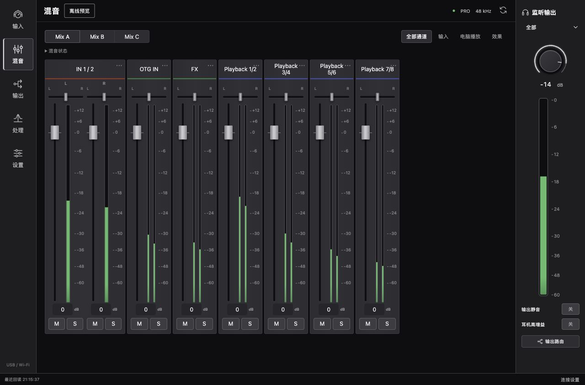
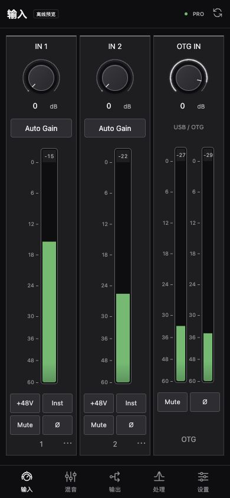

# KB22 Remote

[](https://github.com/shizuon/kb22-remote/actions/workflows/ci.yml)
[](LICENSE)

TOPPING KB22 的独立局域网控制面板：Mac 连接声卡，电脑或手机浏览器控制。

An independent, self-hosted web controller for the TOPPING KB22 audio interface. The hardware service runs on macOS; desktop and mobile browsers provide the control surface. The interface and primary documentation are in Chinese.



在连接 KB22 的 Mac 上运行服务，同一局域网内的手机通过浏览器控制声卡。Mac 需要保持开机并连接 USB。运行时只使用 Python 标准库及 macOS 的 CoreAudio / IOKit，不依赖 KB Control Center 进程。

九个控制页面已实现，覆盖 PRO、GAME、HiFi 的 424 个参数，以及系统音频、Mix A/B/C、配置管理和输入增益测量。协议编码、报告解析、模式与槽位隔离、页面交互和离线模拟设备均已覆盖；真实设备的最终验收仍以 [VALIDATION.md](VALIDATION.md) 中“当前验收边界”为准。

## 启动

需要 macOS、Python 3.10 或更新版本，以及连接到 Mac 的 KB22。

```sh
./start.sh
```

也可双击 `启动 KB22 Remote.command`。终端会显示手机访问地址，形如 `http://192.168.x.x:8787/#token=...`。手机连接同一 Wi-Fi，打开完整地址。首次打开会保存令牌，并从地址栏移除令牌。

请先退出 KB Control Center，避免两个控制程序同时改动声卡。终端按 Control-C 停止服务。若手机打不开，检查 Mac 是否休眠、访客 Wi-Fi 是否隔离设备，以及 macOS 是否允许 Python 的局域网连接。

服务默认监听本机全部网络接口的 8787 端口，使用随机访问令牌。令牌保存在 `data/access-token`，只向可信的同网段设备提供完整访问地址。它是局域网 HTTP 服务，没有云端或公网穿透功能。

## 界面调整（2026-11-01）

桌面与手机统一为“输入 / 混音 / 输出 / 处理 / 设置”五个入口。处理区直接切换 EQ、动态和效果；设置区包含设备、配置与总览。九页功能保留。

输入旋钮常驻显示数值。混音支持只显示输入、电脑播放或效果通道，筛选不改变路由；推子刻度与实际增益映射一致。EQ 在桌面采用紧凑参数行，手机选段后编辑。动态按 IN 1、IN 2、闪避分组，效果分成发送、延迟和混响。低频输出设置、独立回环左右电平、记忆槽和参考曲线收进可展开区域。GAME 的 17 条路由集中在六行三列矩阵。

<details>
<summary>手机输入页截图（离线模拟预览）</summary>



</details>

## 页面和功能

| 页面 | 专业录音 PRO | 电竞 GAME | HiFi |
|---|---|---|---|
| 总览 | 采样率、系统音量/静音、状态 | 同左 | 同左 |
| 输入 | 增益、静音、48V、Hi-Z、接口、反相、降噪；输入电平和增益测量 | 输入控制、人声增强、降噪、电平和增益测量 | USB / OTG 输入选择 |
| 混音 | Mix A/B/C；七组立体声输入；增益、声像、联动、静音、独听、反相 | 各输入/Playback 到耳机、OTG OUT、Recording 的独立路由 | 此模式不提供混音 |
| 输出与回环 | 输出源、接口组合、音量、静音、高增益；八个记忆槽；OTG、三组 Loopback | 输出组合、增益、OTG/Recording、耳机互馈、声音增强 | 音量、静音、输出组合、增益、PCM、平衡、音量步进、反相 |
| 动态处理 | 两路压缩/扩展、闪避和映射 | 闪避与深度 | 此模式不提供此模块 |
| 均衡器 | 两路四段输入 EQ、左右各十段输出 EQ、前级、总开关 | 音色通过输出页的声音增强调整 | 左右十段 PEQ、前级、启用段数和三个设备槽位 |
| 效果 | 发送、声像、返回、串/并联、延迟、18 档节拍、TAP、Studio/Live/Hall 混响和参数记忆 | 此模式不提供此模块 | 此模式不提供此模块 |
| 设备 | 模式、亮度、电平表样式、待机、记忆、按键分配、恢复出厂 | 模式、亮度、待机、按键分配、恢复出厂 | HiFi 专用设备菜单、记忆、按键分配、恢复出厂 |
| 配置 | 保存、重命名、覆盖、删除、JSON 导入导出；包含三组混音 | 同左，按电竞模式保存 | 同左，按 HiFi 模式保存 |

EQ 支持左右联动、重置、参数 JSON 导入导出，以及带 Q 值的 Equalizer APO PK / LP / HP / LS / HS 文本。支持导入两列“频率 Hz、响应 dB”的源/目标参考曲线，并显示源响应叠加 EQ 的估算曲线。参考曲线保存在当前浏览器，随单独的 EQ JSON 一起导出；完整设备配置不包含这些显示用曲线。

输入增益测量是本工具的辅助流程：采集 10 秒输入峰值，以 −12 dBFS 为目标计算建议增益，随后由用户应用。测量不自行切换 48V、输入接口或增益。它不声称与厂商 AUTO 算法完全相同。

## 状态与限制

- “设备回读”表示收到了该参数；“单侧”表示立体声参数仅回传一侧。“已发送 · 未回读”表示 USB 已发送，但没有足够的回传证据。“电脑保存值”不代表设备当前值。
- 拖动旋钮、声像和推子时连续发送；同一参数尚未发送的中间值会合并，保留最后一次操作。页面不会因普通写入禁用正在调整的控件。操作会固定当时的模式、输出记忆槽和混音总线；模式或 HiFi 槽位改变后，旧操作会被拒绝。
- 普通旋钮、开关和混音推子不会为每次操作等待整套配置上传：写入响应直接带回当前内存状态，后台每 500ms 做一次轻量状态核对；收到对应报告后才标记为“设备回读”。初始化、刷新、切换输出记忆槽、切换 HiFi 槽位和完整导入仍会进行完整同步。USB 发送成功本身不等于设备已执行。
- USB 通信错误后停止向同一次连接自动写入。物理重新连接会自动识别新的 USB 连接；也可点击刷新明确重试。模式切换后必须等到新的 USB 连接出现，不向旧连接继续握手。停止服务也会中止握手的后续请求。重复启动时先检查端口占用，避免第二个进程先握手再报错。
- `data/usb-events.jsonl` 记录发出帧、配置回传、系统返回码和错误，单文件约 2 MB，保留三份轮换。连续电平报告不写入诊断日志；日志包含音频设置，没有 PCM 音频或访问令牌。
- PRO 输出参数按八个记忆槽隔离。选择编辑槽位不会切换物理输出接口。完整配置保存的是当前查看的一个输出槽位，不是八个槽位的合并备份。
- 混音推子、独听和联动是电脑端状态。已采集的固件报告不回传完整混音矩阵，因此这些操作可能保持“已发送”。Mix A/B/C 的增益、声像、静音、独听和反相已通过实际 USB 回环信号验证。
- 44.1/48 kHz 才能使用输入 EQ、动态和效果；输出 EQ 可用到 192 kHz。页面和 API 都按模式及采样率限制写入。
- 配置导入在任何写入前检查全部参数、模式和混音结构。USB 中途断开仍可能只完成部分写入；此时会报错，应重新连接、回读并核对，不会声称已全部恢复。
- HiFi 导入先切换设备 PEQ 槽位，确认成功后再写入频段；切槽未确认时中止后续写入。频段发送记录和电脑缓存按设备槽位隔离。单独 EQ JSON 保存每段启用状态。设备回传的段数是已启用频段数量；“启用前 N 段”会打开前 N 段并旁通其余频段，保留频率、增益和 Q。APO 导入保留 ON/OFF 状态。模式切换会重新连接 USB，中断音频。
- 输入、输出、Playback 1/2–7/8、FX 和 Mix 总线电平使用实时数据流和约 60 fps 浏览器绘制。联动状态也显示左右两条电平。数据流最多每秒 60 次，只在实际报告变化时发送；本轮真机约 52.6 次/秒，不能把绘制率当作 USB 报告率。实时接口只取已收到的 USB 缓存，不重复请求全量配置；缺失或过期的电平不会显示模拟信号。离线预览会生成模拟 Playback 电平，真机只显示实际收到的 4909/490a 等报告。
- 恢复出厂需要两次界面确认，第二次输入 `RESET KB22`。发送前保存已读状态到 `data/reset-backup-*.json`；保存失败时不执行恢复。命名配置会保留。恢复记录包含原始回读，不能作为普通配置直接导入；其中的 `snapshot` 为当前模式/当前槽位的普通配置。实际恢复出厂会清除设备设置，本次没有在用户设备上执行。如果恢复后没有重新枚举 USB，可等待至少 5 秒再点击刷新尝试一次回读；不会重发恢复出厂指令。
- 这是独立遥控工具，不含厂商驱动安装、固件升级、官方软件更新或键盘 VIA 配键功能。

## 离线检查与预览

```sh
python3 -m unittest discover -s tests -v
node --test tests/test_write_queue.cjs
python3 tests/serve_preview.py
```

预览只绑定 `127.0.0.1:8788`，使用内存中的模拟设备与空配置，不打开 USB 或 CoreAudio，也不读取本机 KB Center 个人配置。页面持续显示“离线功能预览”，请勿与真正的 8787 控制服务混淆。

已通过 75 项 Python 离线测试和 6 项 JavaScript 队列测试，其中包括 155 组原软件参数指令对照、3 组恢复出厂指令对照、真实配置回传重放、CRC、八槽隔离、Playback 电平解码、过期报告不能冒充回读确认、模式/采样率限制、HiFi 切槽确认与缓存隔离、导入预校验、混音、效果组合参数、配置管理、输入增益测量、恢复出厂确认/写前备份、USB 停写/重连、读取时序、即时写入状态返回、诊断记录及 HTTP 鉴权。测试夹具在 `tests/fixtures`；不包含厂商程序本体。

本地数据存于 `data/`。`runtime.json` 保存混音和已发送参数的电脑记录，`preset-*.json` 为命名配置。备份时保留这些文件；向别人分发程序时不要包含访问令牌或自己的配置。

## 性能对照与消融

下列检查只重放夹具或模拟请求耗时，不打开 USB。Node.js 仅供前端测试使用，日常运行服务不需要安装 Node.js。

```sh
python3 tests/benchmark_metering.py
node tests/benchmark_queue.cjs
```

真机与模拟结果分别记录在 [验收数据](validation/acceptance-20261101.json)。完整读回仍需等待设备上传；本轮强制读回约 10–11 秒，普通交互写入不等待这一过程。

## 开发与贡献

硬件服务仅支持 macOS；离线测试和模拟预览可以在不连接 KB22 的环境中运行。运行时无第三方 Python 包，无 npm 构建步骤。测试需要 Python 3.10+ 与 Node.js 20+。贡献前请阅读 [CONTRIBUTING.md](CONTRIBUTING.md)。

GitHub Actions 自动执行 Python 回归、JavaScript 队列测试和语法检查，不接触真实 USB 设备。发布版截图来自离线模拟器，并非新的实机验收结果。历史实机结果和未解决边界见 [VALIDATION.md](VALIDATION.md)。

## 许可与来源

项目代码和原创 SVG 图标采用 [MIT License](LICENSE)。公开版本使用系统字体，不分发从厂商软件提取的字体、图标、程序或反汇编文件。测试夹具是用于互操作验证的协议输入、输出与设备报告数据，来源说明见 [NOTICE.md](NOTICE.md)。

这是独立社区项目，与 TOPPING 或 Focusrite 无隶属、赞助或官方认证关系；产品名称用于识别兼容设备和设计参考。
